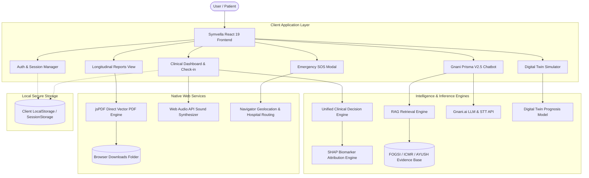

# Symvella (formerly SakhiAI) 🌸
### *Multilingual, Explainable AI Companion & Clinical Intelligence Platform for Women's Health*

[](https://vitejs.dev/)
[](https://react.dev/)
[](https://tailwindcss.com/)
[](#clinical-protocols--medical-evidence-base)
[](#privacy--data-security)
[](LICENSE)

---

## 📌 Executive Summary

Globally, and especially across diverse demographics in India, reproductive and endocrine conditions such as **Polycystic Ovarian Syndrome (PCOS)**, **Primary Dysmenorrhea**, and **Iron-Deficiency Anemia** suffer from an average **7 to 9-year diagnostic delay**. Patients routinely have chronic symptoms dismissed as *"just normal cramps"*, while physicians often receive fragmented, recall-biased patient histories during rushed consultations.

**Symvella** bridges this critical clinical gap. It is an end-to-end, privacy-first progressive web and mobile application that transforms subjective daily symptom logs into **longitudinal, objective clinical intelligence**. Powered by explainable machine learning (Rotterdam Criteria & VAS scoring), Retrieval-Augmented Generation (RAG) grounded in **FOGSI & ICMR guidelines**, a **Digital Twin lifestyle prognosis simulator**, and **1-click instant PDF reports**, Symvella empowers women to self-advocate and provides doctors with consultation-ready diagnostic evidence.

---

## 📑 Table of Contents

1. [Key Features & Capabilities](#-key-features--capabilities)
   - [Clinical Decision Support & Explainable AI (XAI)](#1-clinical-decision-support--explainable-ai-xai)
   - [Digital Twin Lifestyle Prognosis Simulator](#2-digital-twin-lifestyle-prognosis-simulator)
   - [Longitudinal Health Reports & 1-Click PDF Downloads](#3-longitudinal-health-reports--1-click-direct-pdf-downloads)
   - [Gnani Prisma V2.5 Multilingual AI Chatbot with RAG](#4-gnani-prisma-v25-multilingual-ai-chatbot-with-rag)
   - [Daily 60-Second Check-in & Audio Alarm System](#5-daily-60-second-check-in--audio-alarm-system)
   - [Emergency SOS & Geo-Location Hospital Routing](#6-emergency-sos--geo-location-hospital-routing)
   - [Multilingual Accessibility (5 Languages)](#7-multilingual-accessibility-5-languages)
2. [System Architecture](#-system-architecture)
3. [Technology Stack](#-technology-stack)
4. [Quickstart Guide (Run Locally)](#-quickstart-guide-run-locally)
5. [Step-by-Step User Walkthrough](#-step-by-step-user-walkthrough)
6. [Project Directory Structure](#-project-directory-structure)
7. [Clinical Protocols & Medical Evidence Base](#-clinical-protocols--medical-evidence-base)
8. [Privacy & Data Security](#-privacy--data-security)
9. [Android Mobile Deployment (Capacitor)](#-android-mobile-deployment-capacitor)
10. [Medical Disclaimer](#-medical-disclaimer)

---

## 🌟 Key Features & Capabilities

### 1. Clinical Decision Support & Explainable AI (XAI)
* **Rotterdam Consensus PCOS Stratification**: Multi-factorial evaluation scoring cycle irregularity, hyperandrogenism markers (acne, hirsutism), and metabolic variance.
* **Dysmenorrhea & Myometrial Hyper-Reactivity**: Tracks pain sites (lower abdomen, pelvis, lower back) and severity via the clinical **Visual Analogue Scale (VAS 0–10)**.
* **ICMR Anemia Depletion Risk**: Correlates reported fatigue, pallor, flow volume, and dietary iron blocks (e.g. post-meal tannin intake).
* **SHAP Biomarker Attributions**: Generates explainable percentage weightings (`+35% weight: Oligomenorrhea`) so users and doctors understand *why* a particular risk level was flagged.

### 2. Digital Twin Lifestyle Prognosis Simulator
* Allows users to interactively test *what-if* scenarios before clinical flare-ups happen.
* Users slide inputs for **Restorative Sleep** (4h–10h), **Stress Modulation** (1–10), and **Physical Activity** (0–60 mins/day).
* The mathematical simulation engine calculates projected 7-day symptom stability and projected symptom flare probabilities.

### 3. Longitudinal Health Reports & 1-Click Direct PDF Downloads
* **Zero Print Dialogs**: Generates crisp, high-resolution vector PDF documents directly in the browser via `jsPDF` and triggers immediate download to the system's `Downloads` folder in `<100ms`.
* **Weekly Progress Report (`Symvella_Weekly_Progress_Report_<date>.pdf`)**:
  - 7-day logging adherence score.
  - Mean sleep duration, pain VAS average, and daily hydration.
  - Statistical Pearson correlation coefficient ($r$) between sleep duration and pelvic pain sensitivity.
  - Active clinical findings, factor weights, and timeline table.
  - Weekly lifestyle action plan (movement, hydration, sleep hygiene).
* **Monthly Clinical Consultation Summary (`Symvella_Monthly_Clinical_Report_<date>.pdf`)**:
  - Formal gynaecological documentation aligned with **FIGO PALM-COEIN** and **Rotterdam ESHRE/ASRM** standards.
  - Patient demographics, cycle variability index, and LMP.
  - Multi-condition diagnostic impression cards (PCOS, Dysmenorrhea, Anemia).
  - Multi-center clinical benchmark confidence matrix (10,000+ patient records validation).
  - 6-cycle longitudinal symptom timeline.
  - Recommended laboratory workup (USG Pelvis, Day 2–4 Hormonal Profile, CBC/Ferritin) with physical signature and clinic seal block.

### 4. Gnani Prisma V2.5 Multilingual AI Chatbot with RAG
* **Verified Guidelines Grounding**: Integrated with Retrieval-Augmented Generation (RAG) querying verified clinical guidelines from **FOGSI**, **ICMR**, and **WHO**.
* **Clean 3-Card Scannable Readability**:
  - 💡 **Quick Answer**: Direct, empathetic, single-paragraph explanation.
  - 🌿 **What You Can Do (Gharelu Upay & Lifestyle)**: Actionable, evidence-backed home remedies and self-care steps.
  - 🚨 **When to See a Doctor**: High-risk red flags that warrant urgent medical evaluation.
* **Multimodal Voice Interaction**: Real-time voice speech-to-text (Web Speech API / Gnani STT) and voice answer synthesis with auto-stop controls.
* **Transparent Quota Tracker**: In-chat configuration modal showing token usage, quota reset, and custom Gnani API key support.

### 5. Daily 60-Second Check-in & Audio Alarm System
* Quick, non-intimidating modal for recording cycle day, pain intensity, flow volume, mood, restorative sleep, water intake, and cutaneous signs.
* **Native Web Audio API Alarm Synthesizer**: Built-in chime engine requiring zero external audio assets or downloads:
  - 🔔 *Gentle Chime* (dual sinusoidal soothing tones)
  - 🧘 *Morning Zen* (pentatonic calming frequencies)
  - ⚡ *Upbeat Pulse* (energetic rhythm alert)
  - ⏰ *Classic Bell* (traditional metallic chime)
* 1-Tap sound preview and customizable daily reminder time.

### 6. Emergency SOS & Geo-Location Hospital Routing
* Immediate 1-tap SOS modal on the top navigation bar.
* Real-time GPS reverse geocoding to identify the nearest 24/7 OB-GYN emergency casualty center (e.g. Sassoon General Hospital, KEM, District Civil Hospitals).
* Direct 1-tap dialer (`112` Emergency National Hotline, `108` Free Medical Ambulance, and hospital casualty).
* Pre-composed emergency WhatsApp/SMS dispatch including exact GPS location, last logged pain score, and vital details.

### 7. Multilingual Accessibility (5 Languages)
* Full dynamic localization across:
  - 🇬🇧 **English**
  - 🇮🇳 **हिंदी (Hindi)**
  - 🗣️ **Hinglish** (Colloquial conversational mix)
  - 🚩 **मराठी (Marathi)**
  - 🏛️ **தமிழ் (Tamil)**
* Instant single language dropdown on the Login/Signup portal and the Dashboard Navbar.

---

## 🏗️ System Architecture



---

## 💻 Technology Stack

| Category | Technology | Description |
|---|---|---|
| **Frontend Framework** | React 19.3 | Modern concurrent UI architecture |
| **Build Tool & Bundler** | Vite 8.3 | Ultra-fast HMR and ESM bundling |
| **Styling & Design System** | Tailwind CSS v4.0 | Modern CSS cascade layers, custom OKLCH palette |
| **Icons & Visuals** | Lucide React | High-clarity medical and dashboard iconography |
| **PDF Generation** | jsPDF 4.2 | 100% programmatic vector PDF generation (<100ms) |
| **Data Visualization** | Recharts 3.10 | Interactive cycle timeline and physiological charts |
| **Audio Synthesis** | Web Audio API | Zero-dependency native sound frequency generator |
| **AI LLM & Voice** | Gnani.ai / Web Speech | Specialized Indian multilingual speech and LLM APIs |
| **Mobile Runtime** | Capacitor 8.5 | Cross-platform Android deployment support |

---

## 🚀 Quickstart Guide (Run Locally)

Anyone can clone and run this application in less than 2 minutes. All core features (clinical models, digital twin, check-ins, reports, and sound synthesis) run fully client-side out of the box with zero required environment setup.

### Prerequisites
* **Node.js**: `v18.0.0` or higher ([Download Node.js](https://nodejs.org/))
* **npm**: `v9.0.0` or higher (bundled with Node.js)

### 1. Clone the Repository
```bash
git clone https://github.com/your-username/healthcare.git
cd healthcare
```

### 2. Install Dependencies
```bash
npm install
```

### 3. Launch the Local Development Server
```bash
npm run dev
```

Open your browser and navigate to:
```
http://localhost:5173/
```

### 4. Build for Production
To create an optimized production build:
```bash
npm run build
```
To preview the production bundle locally:
```bash
npm run preview
```

---

## 🧭 Step-by-Step User Walkthrough

### 1. Login or Sign Up
1. On first launch, the full-screen **Clinical Health Portal** displays.
2. Select your preferred language (English, हिंदी, Hinglish, मराठी, தமிழ்) using the language selector on the top-right of the card.
3. **Sign In**: Enter any valid 10-digit mobile number (e.g. `9876543210`) and current city (e.g. `Pune, Maharashtra`).
4. Click **Continue to Enter OTP** and enter the 4-digit code (e.g. `1234`).
5. You are immediately routed to your confidential **Home Dashboard**.

### 2. Complete a 1-Minute Daily Check-in
1. Click **Start 1-Min Check-in** on the home dashboard banner.
2. Select your cycle day, pain intensity (0–10), pain location, mood, sleep duration, and water intake.
3. Click **Save Daily Health Entry**.
4. Your health score, risk indicators, and Gharelu Upay home remedy recommendations instantly recalibrate.

### 3. Test the Digital Twin 7-Day Prognosis Simulator
1. Navigate to the **Reports** tab from the bottom navigation bar.
2. Ensure **Weekly Progress & Prognosis Report** is selected.
3. Scroll to **3. Digital Twin 7-Day Lifestyle Prognosis Forecast**.
4. Move the sliders for **Restorative Sleep**, **Stress Modulation**, and **Physical Activity**.
5. Watch the projected flare index and clinical prognosis forecast update dynamically in real time.

### 4. Download Medical PDFs Directly to Your Downloads Folder
1. In the **Reports** tab:
   - To get your personal wellness summary, click **Download Weekly PDF**.
   - To get your formal consultation document for your gynaecologist, click the **Monthly Clinical Consultation Summary (PDF)** tab and click **Download Monthly PDF**.
2. The browser **immediately downloads** the `.pdf` file to your system's `Downloads` folder (e.g., `Symvella_Weekly_Progress_Report_2026-10-25.pdf`).
3. **No print window** or printer confirmation dialog will ever appear.

### 5. Chat with the Symvella Multilingual Companion
1. Tap the floating chat bubble in the bottom-right corner.
2. Type or speak a question in English, Hindi, Hinglish, Marathi, or Tamil (e.g., *"How can I relieve severe pelvic cramps?"* or *"PCOS ke lakshan kya hain?"*).
3. The chatbot responds in a structured, 3-card scannable layout:
   - 💡 **Quick Answer**
   - 🌿 **What You Can Do (Gharelu Upay & Lifestyle)**
   - 🚨 **When to See a Doctor**
4. Tap the speaker icon to listen to the answer read aloud.

### 6. Configure Daily Check-in Alarms
1. Go to **Settings** from the bottom navigation bar.
2. In the **Daily Check-in Alarm** section, pick your preferred reminder time.
3. Select from 4 synthesized tones: *Gentle Chime*, *Morning Zen*, *Upbeat Pulse*, or *Classic Bell*.
4. Tap **Preview Sound** to test the tone via your speakers using the Web Audio API.

---

## 📁 Project Directory Structure

```
healthcare/
├── android/                         # Capacitor native Android project
│   └── app/src/main/                # Native manifests, assets, and Android Java source
├── backend/                         # Standalone background daemon & automation
│   └── alarmDaemon.js               # Background notification runner
├── ml/                              # Python Machine Learning training pipeline
│   ├── models/                      # Serialized ML joblib classifiers & regressors
│   └── train_unified_model.py       # Consolidated clinical training script
├── public/                          # Static public assets
│   ├── favicon.svg                  # Vector SVG favicon
│   └── logo.png                     # Official Symvella emblem logo
├── scripts/                         # Verification & testing suites
│   ├── test_chatbot_engine.js       # Bot logic tester
│   ├── test_gnani_llm.js            # Gnani API integration test
│   ├── test_rag_system.js           # RAG retrieval accuracy verification
│   └── test_remedy_predictions.js   # Herbal remedy ML verification
├── src/                             # Main application source code
│   ├── assets/                      # Application image assets
│   ├── components/                  # Reusable UI components
│   │   ├── BottomNav.jsx            # Persistent 4-tab mobile navigation bar
│   │   ├── ChatFormattedMessage.jsx # 3-card scannable bot output renderer
│   │   ├── DailyReportModal.jsx     # Post-check-in summary modal
│   │   ├── FloatingChatbot.jsx      # Expandable floating AI companion drawer
│   │   ├── Navbar.jsx               # Top navigation bar with logo, language & SOS
│   │   ├── PeriodDateModal.jsx      # Date-picker modal for cycle logging
│   │   ├── PersistentAlarmModal.jsx # Full-screen audio alarm modal
│   │   └── SOSModal.jsx             # Emergency casualty router & dialer
│   ├── context/
│   │   └── AppContext.jsx           # Global state, persistence, and localization
│   ├── data/                        # Static datasets & clinical knowledge engines
│   │   ├── botKnowledge.js          # RAG guidelines, languages, and starter prompts
│   │   ├── emergencyDoctorsCatalog.js # 24/7 casualty hospital directory & geocoder
│   │   ├── ghareluUpayCatalog.js    # Evidence-backed herbal remedies catalog
│   │   ├── ghareluUpayEngine.js     # Symptom-to-remedy recommendation algorithm
│   │   ├── translations.js          # Multilingual string dictionary (5 languages)
│   │   ├── unified_model.json       # Pre-computed multi-task clinical model weights
│   │   ├── unifiedModelEngine.js    # Client-side clinical inference engine
│   │   └── xaiEngine.js             # SHAP attributions & Digital Twin simulator
│   ├── services/                    # Core business logic services
│   │   ├── alarmSchedulerService.js # Web Audio API sound synthesis & scheduling
│   │   ├── ragService.js            # Vector similarity search & RAG grounding
│   │   └── reportPdfGenerator.js    # Direct jsPDF vector document generators
│   ├── utils/
│   │   └── dateUtils.js             # Menstrual cycle math & age calculation helpers
│   ├── views/                       # Primary views and pages
│   │   ├── AuthModal.jsx            # Sign In / Sign Up portal with OTP flow
│   │   ├── CheckInModal.jsx         # 60-second daily holistic symptom check-in
│   │   ├── HomeDashboard.jsx        # Cycle wheel, daily remedies, and health vitals
│   │   ├── InfoHubView.jsx          # Educational clinical library & government schemes
│   │   ├── ReportsView.jsx          # Weekly & Monthly reports with PDF downloads
│   │   ├── SakhiChat.jsx            # Standalone dedicated chat interface
│   │   └── SettingsView.jsx         # Profile settings, alarm sounds, and data reset
│   ├── App.jsx                      # Root application layout & routing controller
│   ├── index.css                    # Tailwind CSS v4 styling rules
│   └── main.jsx                     # Vite entry point
├── index.html                       # HTML5 root template
├── package.json                     # Node.js dependencies and run scripts
└── vite.config.js                   # Vite configuration
```

---

## 🩺 Clinical Protocols & Medical Evidence Base

Symvella does not generate arbitrary generative text for medical claims. All rule-bases, XAI algorithms, and RAG retrieval vectors are grounded in peer-reviewed clinical guidelines:

1. **Rotterdam Consensus (ESHRE / ASRM)**: Recognized international diagnostic criteria for Polycystic Ovarian Syndrome (chronic anovulation, clinical/biochemical hyperandrogenism, and polycystic ovarian morphology).
2. **FOGSI (Federation of Obstetric and Gynaecological Societies of India)**: Good clinical practice recommendations for heavy menstrual bleeding, adolescent dysmenorrhea, and reproductive health triage.
3. **ICMR (Indian Council of Medical Research)**: National nutritional anemia prophylaxis guidelines, dietary iron absorption inhibitors (tannins/phytates), and hemoglobin screening thresholds.
4. **FIGO PALM-COEIN Classification**: Standardized classification system for abnormal uterine bleeding (Polyp, Adenomyosis, Leiomyoma, Malignancy vs. Coagulopathy, Ovulatory dysfunction, Endometrial, Iatrogenic, Not yet classified).
5. **Ministry of AYUSH (Government of India)**: Validated traditional botanical remedies (Ginger, Ajwain, Fennel, Cinnamon, Turmeric) aligned with modern pharmacological anti-inflammatory evidence.

---

## 🔒 Privacy & Data Security

Symvella is built from the ground up to respect patient confidentiality and comply with India's **Digital Personal Data Protection Act (DPDP 2023)**:

* **100% Client-Side Local Storage**: All personal health records, symptom logs, cycle dates, and notes are stored strictly in the user's browser `localStorage` / `sessionStorage`.
* **Zero Third-Party Data Selling**: No health data is sent to advertising networks, third-party analytics trackers, or commercial brokers.
* **Granular Data Purging**: Users can completely wipe their profile, logs, and stored credentials with 1 click from the **Settings** view (**Reset All Data**).
* **Clear Role Boundaries**: The platform clearly states that it guides, tracks, and informs, but does not prescribe scheduled pharmaceutical drugs.

---

## 📱 Android Mobile Deployment (Capacitor)

Symvella is configured for native Android compilation using **Capacitor**:

```bash
# 1. Build the production web bundle
npm run build

# 2. Sync web assets into the Android native project
npx cap sync android

# 3. Open the Android project in Android Studio
npx cap open android
```
From Android Studio, click **Run 'app'** to launch on a connected physical device or Android Virtual Device (AVD).

---

## ⚖️ Medical Disclaimer

> **IMPORTANT MEDICAL NOTICE**:  
> Symvella is an AI-powered clinical intelligence, symptom-tracking, and health education platform designed to assist patients in tracking physiological trends and communicating with licensed medical professionals. **Symvella does not provide definitive medical diagnoses, does not prescribe pharmaceutical drugs, and does not replace the clinical judgment of a qualified gynaecologist, endocrinologist, or emergency physician.**  
>
> If you experience acute symptoms such as sudden severe lower abdominal pain, heavy bleeding soaking through more than two pads per hour for consecutive hours, severe dizziness, or high fever with pelvic pain, use the in-app **Emergency SOS** button immediately or call **112 / 108**.

---

<p align="center">
  <strong>Symvella</strong> • Dedicated to Accessible, Dignified, and Clinically Rigorous Women's Healthcare.
</p>
